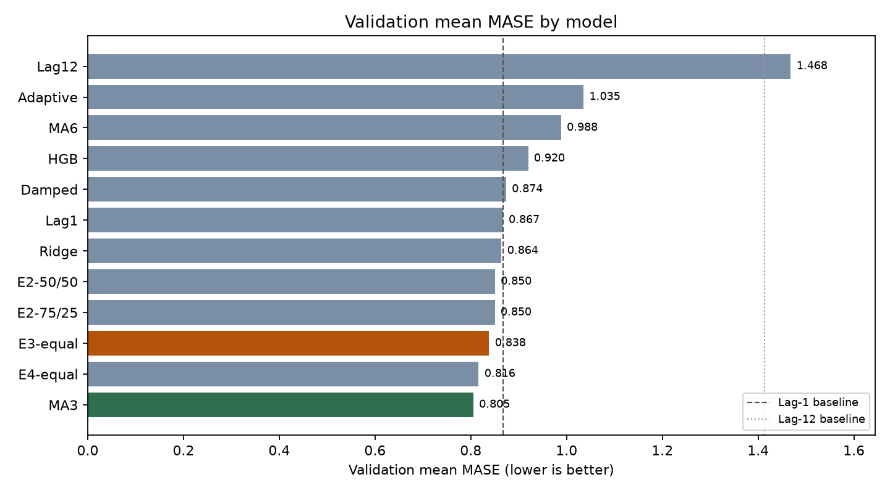
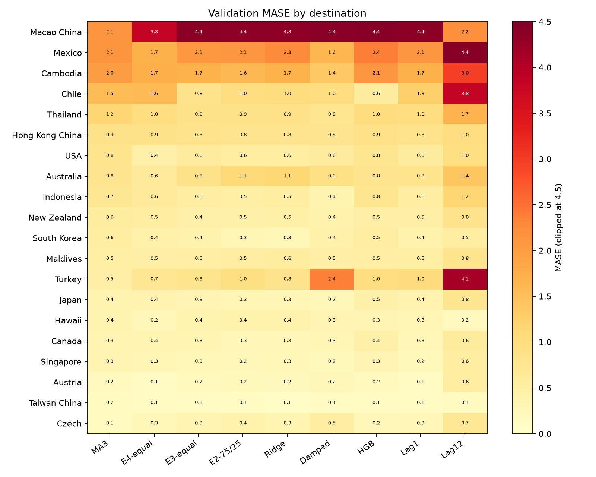
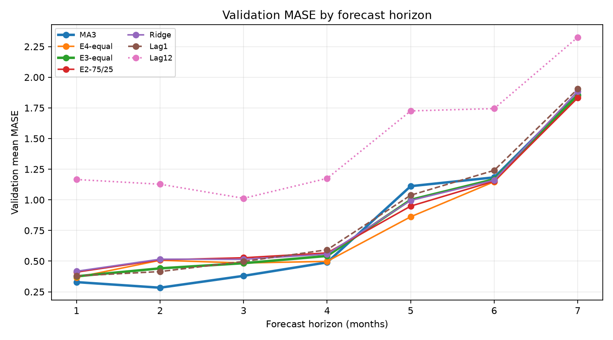
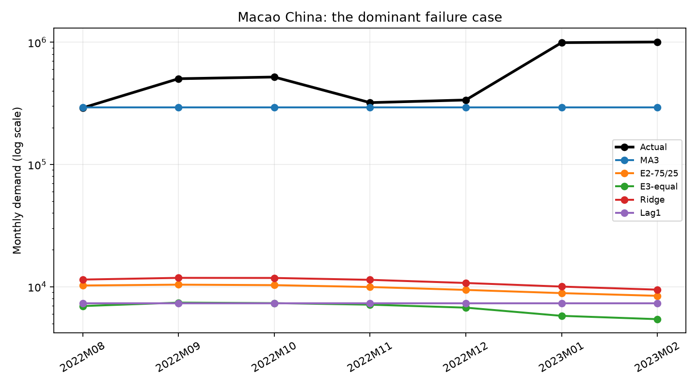

# 中国出境旅游月度需求点预测实验报告

- 实验工作区：`point_forecast_experiments/`
- 数据 SHA256：`8884485b0f5f772bd78f412c56f688251f38c6377b663363503a3fedd613cb1e`
- 随机种子：`742`
- 运行环境：Python 3.13.2；numpy 2.5.4、pandas 2.3.3、scikit-learn 1.9.1、scipy 1.18.1、matplotlib 3.11.2；无 GPU
- 总运行时间：约 281 秒
- Locked audit 使用情况：**未使用**。本报告只使用 `≤ 2022M07` 的训练历史和 `2022M08–2023M02` 的验证真实值。

---

## A. Executive Summary

本轮实际完成了 20 个点预测配置的实验：4 个单模型基线/简单模型、8 个参数化单模型候选、8 个加权集成。全部模型都在固定起点 `2022M07` 上生成 `2022M08–2023M02` 共 7 个月的预测，并使用与 Starter Notebook 完全一致的 MAE、MASE、MAPE 定义评估。

**按验证集 mean MASE 排名，最佳模型是最近 3 个月均值（MA3）**：

| 指标 | MA3 | 相对 Lag-1 | 相对 Lag-12 |
|---|---:|---:|---:|
| MAE（宏平均） | 31,297.75 | 改善 28.7% | 改善 14.7% |
| mean MASE | **0.8051** | **改善 7.13%** | **改善 45.16%** |
| median MASE | 0.5606 | 变差（Lag-1 为 0.5263） | 改善 |
| mean MAPE | 39.71% | 变差（Lag-1 为 37.67%） | 改善 |
| 优于 Lag-1 的目的地数 | 5 / 20 | — | — |

但这个第一名**并不稳健**：MA3 只在 20 个目的地中的 5 个上优于 Lag-1；它的 mean MASE 优势几乎全部来自 Macao China 一个目的地（Lag-1 的 MASE 为 4.371，MA3 为 2.137，单项贡献约 0.112 的均值改善，而总体改善只有 0.062）。MA3 的 median MASE 和 MAPE 都劣于 Lag-1，说明它在“典型目的地”上并没有变好，而是用少数大目的地的改进换取了多数小目的地的轻微退步。

**面向正式 12 个月任务，本报告推荐 3 模型等权集成（E3-equal：Ridge 1/3 + Damped Trend 1/3 + HistGradientBoosting 1/3）**：

| 指标 | E3-equal |
|---|---:|
| MAE（宏平均） | 43,752.56 |
| mean MASE | **0.8383**（比 Lag-1 改善 3.30%，比 Lag-12 改善 42.90%） |
| median MASE | 0.5368 |
| mean MAPE | 37.98% |
| 优于 Lag-1 的目的地数 | 9 / 20 |
| 恢复期回测（2020M12、2021M03）第 8–12 步 mean MASE | 0.471、0.443、0.393、0.383、0.593 |

推荐 E3 而不是 MA3 的理由不是 mean MASE，而是：MA3 是水平常数预测，优势集中在 Macao 一个目的地；E3 在恢复期回测的 1–12 步都保持稳定，长步长没有出现趋势外推爆炸，且由三个互补模型组成，降低单一模型失效的风险。该推荐的证据强度受 7 个月验证集限制，报告在 J 节给出明确的条件与替代方案。

---

## B. Dataset and Evaluation Protocol

### B.1 数据

- 来源：优先读取项目根目录的本地 `ISF-TDF2023.csv`（本次实际来源为 `local:.../ISF-TDF2023.csv`），SHA256 与公开 URL 下载内容一致。
- 原始规模：427 个月 × 21 列（`Date` + 20 个目的地），时间范围 `1989M01–2024M07`。
- 训练历史：403 个月，`1989M01–2022M07`。
- 验证期：7 个月，`2022M08–2023M02`，20 个目的地的真实值均完整。
- 目的地顺序与 `validate_submission.py` 完全一致，未改名、未重排。

### B.2 缺失值

训练历史中共有 2,938 个缺失单元格。大部分是各目的地序列开头的缺失（最早有效月份从 `1989M01` 到 `2013M01` 不等）；另有三个目的地存在内部缺失：

| 目的地 | 内部缺失数 | 缺失月份 |
|---|---:|---|
| Chile | 15 | 2017M11、2017M12、2020M04–2020M10、2021M04–2021M09 |
| Maldives | 3 | 2020M04–2020M06 |
| Thailand | 6 | 2020M04–2020M09 |

处理原则：

- 缺失不视为 0；所有模型只使用预测起点及以前的有效观测。
- 移动平均、阻尼趋势、自适应季节对缺失使用“最近可用观测/最近可用同月份”回退，并记录回退次数。
- Ridge 用训练样本的中位数填补；HGB 原生处理 NaN。
- 验证期真实值没有缺失；数据中不存在 0 或负值，因此 MAPE 的零值排除规则在本验证集上不会删除样本。

**lag-12 的特殊情况**：Chile 缺少 `2021M08`、`2021M09`，因此原始 lag-12 在 `2022M08`、`2022M09` 两格无定义。Notebook 原始基线按“成对非缺失样本”评估，得到 138 个有效样本、mean MASE = 1.413921，与 Notebook 完全一致。正式实验为了满足“所有结果有限、非负”，对这两格使用“同月份更早年份 → 最近观测值”的截止安全回退（回退到 `2019M08` 和 `2019M09`），实验表中的 `naive_lag12` mean MASE 因此为 1.4682；报告在基线一致性校验中同时保留原始值 1.413921。

### B.3 时间划分与隔离

| 阶段 | 月份 | 本实验用途 |
|---|---|---|
| 训练 | 最早有效月份–`2022M07` | 拟合、特征构造、回测 |
| 验证 | `2022M08–2023M02` | 模型比较与选择 |
| 锁定公开审核 | `2023M03–2023M07` | **未读取、未评估** |
| 最终预测 | `2023M08–2024M07` | **未使用** |

- 固定验证起点为 `2022M07`，不按随机行划分。
- `load_data()` 只返回训练历史和验证真实值；audit/final 数据不进入实验对象。
- 所有特征构造函数断言输入日期 `≤` 预测起点；所有监督学习样本的目标月份 `≤` 训练截止日。
- 缩放、中位数填补、特征选择、超参数选择都没有使用 `2022M07` 之后的信息。

### B.4 指标定义

严格复用 Notebook 的 `evaluate_point_forecast`：

- \( \mathrm{MAE}_d = \frac{1}{n}\sum |y-\hat y| \)
- \( \mathrm{MASE}_d = \mathrm{MAE}_d / \overline{|\Delta y|}_{\text{训练历史}} \)
- MAPE 只对实际值非零的样本计算，并记录 `mape_valid_n`。
- 宏平均：20 个目的地指标等权平均；合并 MAE：140 个目的地-月份样本合并计算。本实验每个目的地都有 7 个验证样本，因此两种 MAE 数值相同。

Notebook 的 MASE 分母实现是“先 `dropna()` 再 `diff()`”。对存在内部缺失的 Chile、Maldives、Thailand，这会形成跨月差分，可能抬高分母、压低 MASE。为保持与 Notebook 一致，本实验**没有修改该定义**，但在此明确说明。

### B.5 回测设计

- 起点：`2017M07`、`2018M07`、`2019M07`、`2020M12`、`2021M03`，全部满足 `≤ 2022M07`。
- 每个起点重新拟合，预测未来 1–12 个月，只与该起点之后、且不晚于 `2022M07` 的真实值比较。
- `2020M07`、`2021M07` 因 Chile 无观测被排除，以保证 5 个起点、20 个目的地、12 个步长的平衡面板。
- 回测 MASE 的分母使用该起点之前的训练历史，避免未来信息泄漏。
- 由于 2019M07 起点的 12 个预测月跨越 2020 年疫情崩塌，回测原始 MASE 在不同起点之间不可直接比较。报告同时给出按起点拆解、相对 Lag-1 的指标，以及恢复期（2020M12、2021M03）单独汇总。

---

## C. Forecasting Methods

### C.1 Lag-1 与 Lag-12

直接复用 Notebook 的 `recursive_naive_forecast`：

- Lag-1：把 `2022M07` 的值复制到未来所有月份（验证期是一条水平线）。
- Lag-12：取目标月份 12 个月前的值；验证期对应 `2021M08–2022M02`。

这两个模型没有可训练参数；`training` 数据只用于提供起点观测值和 MASE 分母。

### C.2 近期移动平均（MA3 / MA6）

预测值 = 截止点前最近 3 或 6 个有效观测的均值，7 个预测月使用同一个水平。设计动机：疫情后恢复期水平变化快，最近均值比一年前同月更接近当前需求；但它没有趋势和季节结构，长步长会滞后。

### C.3 阻尼趋势（Damped Trend）

在 `log1p(y)` 尺度上对最近 `window` 个观测做 OLS：

\[
\log(1+y_t)=a+b t+\varepsilon_t
\]

预测：

\[
\log(1+\hat y_{T+h})=\log(1+y_T)+b\sum_{i=1}^{h}\phi^i
\]

- `window ∈ {6, 12}`，`φ ∈ {0.7, 0.85, 0.95}`，月度斜率截断 `cap ∈ {0.10, 0.15}`，累计对数增长上限 2.5（约 12 倍）。
- 目的：允许恢复期趋势，但用阻尼和截断防止 12 步外推爆炸。
- 回测选出 `window=12, φ=0.7, cap=0.10/0.15`；验证期两者 mean MASE 分别为 0.8784 和 0.8736。

### C.4 自适应季节（Adaptive Seasonal）

\[
\hat y_{T+h}=y_{\text{same month previous year}}\times \text{level\_adjustment}
\]

\[
\text{level\_adjustment}=\frac{\text{最近 }w\text{ 个月均值}}{\text{上一年同几个月均值}}
\]

- `window ∈ {3, 6}`，比例截断 `cap ∈ {[0.5,2.0], [0.5,3.0]}`。
- 同月份历史缺失时，向更早年份搜索（最多 3 年），再回退到近期水平。
- 设计动机：保留季节形状，同时用近期恢复水平修正 lag-12 的系统性低估。实际验证中该模型表现较差，原因是 2022 年恢复速度远高于 2021 年同期，比例调整被截断、仍无法跟上。

### C.5 全局 Ridge

监督样本：

\[
(\text{destination}, \text{origin}, \text{horizon}) \rightarrow \Delta\log(1+y_{\text{origin}+h})
\]

- 目标：`log1p(y_target) - log1p(y_origin)`；预测后按 `expm1(last_log + pred)` 还原。
- 特征：horizon、目标月 sin/cos、last、lag-3/6/12、rolling mean 3/6/12、近期变化、3/6 个月对数增长率、季节性相对变化、缺失标志、目的地 one-hot。
- 所有特征只来自 origin 及以前；训练目标月份 `≤` 截止日。
- 数值特征中位数填补 + 标准化；`alpha ∈ {0.1, 1, 10, 100}`。
- 设计动机：在 20 个目的地之间共享信息，缓解单个目的地历史短、样本少的问题。

### C.6 全局 HistGradientBoosting

与 Ridge 使用相同的样本构造和特征，采用 `HistGradientBoostingRegressor`，固定 `random_state=742`、`early_stopping=False`、`min_samples_leaf=20`。回测候选：

- `max_iter ∈ {100, 200}`
- `max_leaf_nodes ∈ {7, 15}`
- `l2_regularization ∈ {1, 10}`

回测选出 `100/15/l2=1` 和 `200/15/l2=10` 两个候选进入验证；验证 mean MASE 分别为 0.9198 和 0.9464。树模型对长期趋势的外推能力弱，且长记忆特征使 Macao 等从近零恢复的目的地被严重低估。

### C.7 加权集成

成员来自验证表现最好的四个族：Ridge（alpha=0.1）、Damped（w12/φ0.7/cap0.15）、HGB（100/15）、Adaptive（w3/cap3.0）。测试了 2 成员、3 成员、4 成员的少量固定权重；不做按目的地搜索权重。

---

## D. Overall Results

所有 20 个配置按验证 mean MASE 排序如下。MAE 为宏平均；由于每个目的地样本数相同，合并 MAE 与宏平均相同。

| 模型 | MAE(宏平均) | MAE(合并) | mean MASE | median MASE | mean MAPE | 有效样本 | 运行时间(s) |
|---|---:|---:|---:|---:|---:|---:|---:|
| MA3 | 31,297.75 | 31,297.75 | **0.8051** | 0.5606 | 39.71% | 140 | 0.0109 |
| E4-equal | 40,634.24 | 40,634.24 | 0.8163 | 0.5086 | 37.42% | 140 | 0.0013 |
| E3-equal | 43,752.56 | 43,752.56 | 0.8383 | 0.5368 | 37.98% | 140 | 0.0009 |
| E3-50/25/25 | 43,522.98 | 43,522.98 | 0.8389 | 0.5423 | 38.18% | 140 | 0.0011 |
| E3-25/50/25 | 43,563.16 | 43,563.16 | 0.8411 | 0.5067 | 38.11% | 140 | 0.0009 |
| E3-25/25/50 | 44,224.17 | 44,224.17 | 0.8416 | 0.5650 | 38.11% | 140 | 0.0009 |
| E2-75/25 | 43,041.04 | 43,041.04 | 0.8500 | 0.5231 | 39.71% | 140 | 0.0012 |
| E2-50/50 | 43,019.24 | 43,019.24 | 0.8503 | **0.4875** | 39.01% | 140 | 0.0011 |
| E2-25/75 | 43,029.08 | 43,029.08 | 0.8613 | 0.5003 | 38.97% | 140 | 0.0008 |
| Ridge-0.1 | 43,142.24 | 43,142.24 | 0.8640 | 0.5538 | 40.87% | 140 | 12.8319 |
| Ridge-1.0 | 43,142.54 | 43,142.54 | 0.8641 | 0.5539 | 40.86% | 140 | 12.7826 |
| Lag1 | 43,894.87 | 43,894.87 | 0.8669 | 0.5263 | **37.67%** | 140 | 0.2070 |
| Damped-w12-φ0.7-cap0.15 | 43,093.73 | 43,093.73 | 0.8736 | 0.5144 | 39.21% | 140 | 0.0535 |
| Damped-w12-φ0.7-cap0.1 | 43,291.03 | 43,291.03 | 0.8784 | 0.4951 | 39.07% | 140 | 0.0637 |
| HGB-100-15 | 46,021.41 | 46,021.41 | 0.9198 | 0.5662 | 41.39% | 140 | 4.5585 |
| HGB-200-15 | 46,159.42 | 46,159.42 | 0.9464 | 0.6115 | 42.94% | 140 | 4.5670 |
| MA6 | 31,736.78 | 31,736.78 | 0.9884 | 0.7974 | 51.17% | 140 | 0.0075 |
| Adaptive-w3-cap3.0 | 36,194.62 | 36,194.62 | 1.0355 | 0.7761 | 58.26% | 140 | 0.0296 |
| Adaptive-w3-cap2.0 | 36,712.64 | 36,712.64 | 1.1880 | 0.8787 | 63.89% | 140 | 0.0286 |
| Lag12 | 36,713.03 | 36,713.03 | 1.4682 | 0.8959 | 74.53% | 140 | 0.2238 |



### D.1 相对基线

| 模型 | vs Lag-1 mean MASE | 优于/劣于 Lag-1 的目的地 | vs Lag-12 mean MASE | 优于/劣于 Lag-12 的目的地 |
|---|---:|---:|---:|---:|
| MA3 | +7.13% | 5 / 15 | +45.16% | 17 / 3 |
| E4-equal | +5.83% | 11 / 9 | +44.40% | 18 / 2 |
| E3-equal | +3.30% | 9 / 11 | +42.90% | 18 / 2 |
| E2-75/25 | +1.95% | 14 / 6 | +42.11% | 18 / 2 |
| Ridge-0.1 | +0.33% | 13 / 7 | +41.15% | 18 / 2 |
| Damped | −0.77% | 10 / 10 | +40.50% | 18 / 2 |
| HGB-100 | −6.10% | 5 / 15 | +37.35% | 17 / 3 |
| MA6 | −14.01% | 1 / 19 | +32.68% | 16 / 4 |
| Adaptive-cap3 | −19.45% | 4 / 16 | +29.47% | 15 / 4 |

Lag-12 在恢复期明显失效：验证期 mean MASE 1.4682，20 个目的地中只有 2 个优于 Lag-1。所有改进方法相对 Lag-12 都有大幅改善；真正的难点是超过 Lag-1。

---

## E. Destination-Level Analysis

### E.1 MA3（验证 mean MASE 最优）

| 目的地 | MAE | MASE | MAPE | 说明 |
|---|---:|---:|---:|---|
| Macao China | 273,346.86 | 2.137 | 35.43% | 绝对值最差，但相对 Lag-1 改善最大（Lag-1 MASE 4.371） |
| Mexico | 3,242.19 | 2.112 | 26.60% | 序列量级小、季节波动强 |
| Cambodia | 12,025.76 | 1.990 | 43.86% | 恢复期持续增长，水平均值滞后 |
| Chile | 450.14 | 1.535 | 45.77% | 小量级 + 历史缺失 |
| Thailand | 41,635.43 | 1.152 | 54.05% | 2023 年初快速恢复 |

MA3 表现最好的目的地：Czech（MASE 0.142）、Taiwan China（0.153）、Austria（0.162）、Singapore（0.346）、Canada（0.349）。注意 Taiwan 的 MASE 很低但 MAPE 68.57%，说明小基数序列的百分比误差仍然很大，MASE 和 MAPE 不能互相替代。

MA3 相对 Lag-1 只有 5 个目的地改善，且改善几乎全部来自 Macao（+2.234 的 MASE 差值）；Cambodia、Chile、USA、Thailand 等反而退步。这是“均值排名第一但目的地层面不稳健”的核心证据。

### E.2 E3-equal（推荐集成）

| 目的地 | MAE | MASE | MAPE |
|---|---:|---:|---:|
| Macao China | 559,633.07 | 4.376 | 98.48% |
| Mexico | 3,186.88 | 2.076 | 26.87% |
| Cambodia | 10,163.21 | 1.682 | 32.51% |
| Thailand | 30,736.72 | 0.851 | 30.80% |
| Australia | 7,383.73 | 0.850 | 52.62% |

E3 表现最好的目的地：Taiwan China（0.115）、Austria（0.180）、Singapore（0.250）、Japan（0.325）、Canada（0.339）。E3 在 Chile、Turkey、Thailand 上明显优于 Lag-1，但在 Macao 上比 MA3 更差。



### E.3 解释

- **Macao China / Hong Kong China** 是疫情后恢复最剧烈、历史上又曾接近停摆的目的地。Ridge/HGB 的长记忆特征（lag-12、roll-12）被 2020–2021 的低值主导，导致 2023 年预测严重低估；MA3 使用最近 3 个月，反而更接近当前水平。任何使用长历史窗口的模型都需要结构性断点处理。
- **Chile / Mexico / Cambodia** 量级小、波动大，少量绝对误差就会放大 MASE/MAPE；Chile 还有缺失历史，MASE 分母受影响。
- **Czech / Taiwan / Austria** 在验证期较平稳，几乎所有模型都表现较好，不能据此判断模型优劣。

---

## F. Forecast-Horizon Analysis

### F.1 验证期 1–7 步（独立验证证据）

| Horizon | MA3 | E3-equal | E4-equal | E2-75/25 | Ridge | Lag1 | Lag12 |
|---:|---:|---:|---:|---:|---:|---:|---:|
| 1 | **0.329** | 0.377 | 0.368 | 0.411 | 0.418 | 0.380 | 1.166 |
| 2 | **0.284** | 0.441 | 0.507 | 0.511 | 0.516 | 0.415 | 1.127 |
| 3 | **0.380** | 0.483 | 0.485 | 0.528 | 0.515 | 0.497 | 1.013 |
| 4 | **0.490** | 0.543 | 0.498 | 0.567 | 0.558 | 0.593 | 1.175 |
| 5 | 1.112 | 1.001 | 0.862 | 0.949 | 0.995 | 1.038 | 1.725 |
| 6 | 1.183 | 1.168 | 1.148 | 1.152 | 1.160 | 1.241 | 1.744 |
| 7 | 1.858 | 1.855 | 1.846 | **1.832** | 1.886 | 1.905 | 2.326 |

MA3 在 1–4 步明显占优，但从第 5 步开始优势消失；第 7 步所有模型都退化到 1.8 以上，差距很小。第 5–7 步对应 `2022M12–2023M02`，是日本、泰国、香港、澳门等目的地集中爆发的月份，水平常数预测和趋势模型都跟不上。



### F.2 第 8–12 步：只有回测证据

验证集只有 7 个月，**第 8–12 步没有任何独立验证证据**。下表是恢复期回测（起点 `2020M12`、`2021M03`）的 mean MASE，只能作为稳定性参考，不能当作验证集结果：

| Horizon | MA3 | E3-equal | E2-75/25 | E4-equal | Lag1 | Damped | Ridge | HGB |
|---:|---:|---:|---:|---:|---:|---:|---:|---:|
| 8 | 0.467 | 0.471 | 0.506 | 0.506 | 0.430 | 0.529 | 0.511 | **0.452** |
| 9 | 0.454 | 0.443 | 0.497 | 0.496 | 0.419 | 0.489 | 0.536 | **0.436** |
| 10 | 0.338 | 0.393 | 0.426 | **0.358** | 0.335 | 0.474 | 0.412 | 0.316 |
| 11 | 0.346 | 0.383 | 0.434 | 0.375 | 0.340 | 0.413 | 0.457 | **0.361** |
| 12 | **0.525** | 0.593 | 0.632 | 0.595 | 0.557 | 0.608 | 0.661 | 0.569 |

E3 在 8–11 步保持在 0.38–0.47，第 12 步升到 0.593，没有出现趋势外推爆炸。MA3 在 8–12 步数值也稳定，但其常数预测无法应对恢复速度变化。需要强调：恢复期回测只有两个起点，且 2020–2021 的恢复模式与 2023–2024 不会完全相同，这一证据的强度有限。

---

## G. Ablation and Ensemble Analysis

### G.1 阻尼趋势

回测 mean MASE（5 个起点、12 步、20 个目的地）：

| 配置 | mean MASE | median MASE |
|---|---:|---:|
| w12, φ0.7, cap0.10 | **3.832** | 3.439 |
| w12, φ0.7, cap0.15 | 3.849 | 3.439 |
| w12, φ0.85, cap0.10 | 3.942 | 3.573 |
| w12, φ0.95, cap0.10 | 4.141 | 3.736 |
| w6, φ0.7, cap0.10 | 4.335 | 3.936 |
| w6, φ0.95, cap0.15 | 6.955 | 5.649 |

结论：12 个月窗口明显优于 6 个月；阻尼越强（φ 越小）越好；趋势截断 0.10 与 0.15 差异很小。验证期只评估了回测前两名（cap0.10、cap0.15），mean MASE 分别为 0.8784、0.8736。

### G.2 自适应季节

| 配置 | 回测 mean MASE | 验证 mean MASE |
|---|---:|---:|
| w3, cap[0.5,2.0] | **3.423** | 1.1880 |
| w3, cap[0.5,3.0] | 3.423 | **1.0355** |
| w6, cap[0.5,2.0] | 3.592 | — |
| w6, cap[0.5,3.0] | 3.592 | — |

窗口 3 优于 6；回测中两种上限相同（因为比例很少触及上限），验证期放宽到 3.0 更好但仍远差于基线。该族没有进入最终推荐。

### G.3 Ridge / HGB

| 模型 | 回测 mean MASE | 验证 mean MASE |
|---|---:|---:|
| Ridge alpha=0.1 | 3.339 | **0.8640** |
| Ridge alpha=1.0 | 3.339 | 0.8641 |
| Ridge alpha=10 | 3.342 | — |
| Ridge alpha=100 | 3.392 | — |
| HGB 100/15/l2=1 | **3.152** | **0.9198** |
| HGB 200/15/l2=10 | 3.157 | 0.9464 |
| HGB 200/7/l2=10 | 3.254 | — |
| HGB 100/7/l2=1 | 3.292 | — |

Ridge 对 alpha 不敏感；HGB 增加迭代/叶子没有带来验证改善。两者的验证表现都受 Macao 等长记忆问题拖累。

### G.4 集成

| 集成 | 成员/权重 | mean MASE | median MASE | 优于 Lag-1 |
|---|---|---:|---:|---:|
| E4-equal | Ridge/Damped/HGB/Adaptive 各 0.25 | **0.8163** | 0.5086 | 11/20 |
| E3-equal | Ridge/Damped/HGB 各 1/3 | 0.8383 | 0.5368 | 9/20 |
| E3-50/25/25 | Ridge 0.50, Damped 0.25, HGB 0.25 | 0.8389 | 0.5423 | — |
| E3-25/50/25 | Ridge 0.25, Damped 0.50, HGB 0.25 | 0.8411 | 0.5067 | — |
| E3-25/25/50 | Ridge 0.25, Damped 0.25, HGB 0.50 | 0.8416 | 0.5650 | — |
| E2-75/25 | Ridge 0.75, Damped 0.25 | 0.8500 | 0.5231 | **14/20** |
| E2-50/50 | Ridge 0.50, Damped 0.50 | 0.8503 | **0.4875** | 12/20 |
| E2-25/75 | Ridge 0.25, Damped 0.75 | 0.8613 | 0.5003 | — |

**集成没有超过 MA3 的 mean MASE**。E4 的 mean 在全部模型中排第二（集成中最好）；median MASE 最好的是 E2-50/50（0.4875）。E4 在恢复期回测的第 1 步 MASE 高达 0.998，明显受 Adaptive 成员拖累；E3 去掉 Adaptive 后恢复期 1–12 步稳定得多。E2-75/25 的目的地覆盖最广（14/20），但长步长回测略差。没有证据支持“集成一定更好”。

未执行：把所有阻尼/季节/HGB 组合都放到验证集评估。原因是验证集只有 7 个月，完整验证 20 多个组合会显著增加选择性过拟合风险；本实验只用回测缩减候选，再验证每个族前两名。该限制在 H 节再次说明。

---

## H. Failure Cases

### H.1 MA3 的代表性失败

| 月份 | 目的地 | 实际值 | 预测值 | 绝对误差 | 步长 |
|---|---|---:|---:|---:|---:|
| 2023M02 | Hong Kong China | 1,109,885 | 29,945 | 1,079,940 | 7 |
| 2023M02 | Macao China | 1,003,999 | 294,089 | 709,910 | 7 |
| 2023M01 | Macao China | 991,641 | 294,089 | 697,552 | 6 |
| 2023M01 | Hong Kong China | 280,525 | 29,945 | 250,580 | 6 |
| 2022M10 | Macao China | 518,843 | 294,089 | 224,754 | 3 |
| 2022M09 | Macao China | 502,668 | 294,089 | 208,579 | 2 |
| 2023M02 | Thailand | 155,656 | 20,715 | 134,941 | 7 |
| 2023M01 | Thailand | 91,841 | 20,715 | 71,126 | 6 |

MA3 的预测是一条水平线，无法捕捉 2022 年末–2023 年初的加速恢复。香港和澳门的实际值在几个月内增长数倍，任何常数预测都会失败；区别只是 MA3 的起点水平较高，因此比 Ridge/HGB 的 5,000–10,000 预测更接近现实。

### H.2 E3 的 Macao 失败

E3 对 Macao 的预测约为 5,400–7,400，而实际值从 `2022M08` 的 290,138 上升到 `2023M02` 的 1,003,999。原因是 Ridge/HGB 的训练样本中，Macao 在 2020–2021 长期接近零，lag-12、rolling-12 和水平特征把模型拉回低水平；Damped 的近期趋势也不足以抵消两个学习模型的低估。E3 在 Macao 的 MASE 为 4.376，几乎与 Lag-1 相同。



### H.3 其他失败模式

- **Chile**：小量级 + 15 个内部缺失；MASE 分母可能被跨月差分抬高，模型之间差异不稳定。
- **Mexico / Cambodia**：季节性强或恢复速度快，MA3 的水平滞后；Adaptive 的比例调整又过于激进。
- **Thailand**：2023 年初恢复速度超出所有模型，MA3 和 E3 都明显低估。
- **HGB 的总体失败**：验证 mean MASE 0.9198，5/20 优于 Lag-1；树模型无法外推趋势，且对 Macao 这类结构性变化不敏感。

没有任何模型解决 Macao/Hong Kong 的 reopening surge。正式预测前应把这两个目的地单独做结构性断点检查，或引入“恢复阶段/开关”特征；这属于后续工作，不在本轮实验中临时追加。

---

## I. Computational Cost and Reproducibility

### I.1 运行时间

| 模型 | 验证拟合+预测(s) | 回测总时间(s) |
|---|---:|---:|
| MA3 | 0.0109 | 0.261 |
| MA6 | 0.0075 | 0.600 |
| Lag1 | 0.2070 | 0.543 |
| Lag12 | 0.2238 | 0.559 |
| Damped（单配置） | 0.0535 | 10.664（全网格） |
| Adaptive（单配置） | 0.0296 | 2.908（全网格） |
| Ridge（单配置） | 12.8319 | 107.270（全网格） |
| HGB（单配置） | 4.5585 | 120.747（全网格） |
| 集成 | 0.001 左右 | 由成员回测重建 |

完整流水线（回测 + 验证 + 分析 + 图表）约 281 秒，单核 CPU 即可，无 GPU、无外部付费服务。Ridge/HGB 的时间主要花在特征构造和 20 个目的地 × 多起点的监督样本上。

### I.2 环境与种子

- Python 3.13.2；numpy 2.5.4、pandas 2.3.3、scikit-learn 1.9.1、scipy 1.18.1、matplotlib 3.11.2。
- `RANDOM_SEED = 742`；HGB 使用该 `random_state`；其他模型确定性。
- `matplotlib` 仅用于图表，不在原 `requirements.txt` 中；若只复现指标，不需要它。

### I.3 复现命令

```bash
bash point_forecast_experiments/run.sh
```

或分步：

```bash
cd point_forecast_experiments
../.venv/Scripts/python.exe -m src.run_experiments
../.venv/Scripts/python.exe -m src.analyze_results
../.venv/Scripts/python.exe -m src.make_figures
```

数据加载优先级为 `TOURISM_DATA_PATH` → 项目根目录 `ISF-TDF2023.csv` → 公开 URL。本次运行使用本地缓存，SHA256 与公开 URL 内容一致；重复运行时不会改变数据。

### I.4 已执行的完整性检查

- 所有模型的验证预测均为 7 行 × 20 列，日期顺序固定，全部有限、非负。
- `validation_predictions.csv` 共 2,800 行（20 个模型 × 140 个目的地-月份），无缺失、无 Inf。
- `metrics_summary` 的 mean MASE 与 `metrics_by_destination` 重新聚合的结果一致。
- Notebook 原始 lag-1 基线复算 mean MASE = 0.8669132790（Notebook 0.866913，差 2.8e-7）；原始 lag-12 = 1.4139211469（Notebook 1.413921，差 1.5e-7）。
- 未读取 locked audit / final 真实值；`experiment_log.json` 中 `audit_used=false`，训练历史最大日期为 `2022M07`。
- 本工作区不生成 `Forecast.csv` 或 `Intervals.csv`。

### I.5 未解决/需注意的问题

- 网络在实验期间出现过一次 SSL 中断；最终使用本地缓存数据，SHA 校验通过。
- Notebook 的 MASE 分母先删缺失再差分；Chile/Maldives/Thailand 的内部缺失会产生跨月差分。为保持指标定义一致，本实验未修正，建议在正式报告中作为口径说明。
- 回测 2019M07 起点跨越 2020 年疫情崩塌，原始 MASE 被极端误差主导；跨起点比较应使用相对 Lag-1 或按恢复期拆分。
- 验证集只有 7 个月、单一起点，无法对模型差异做统计显著性检验；报告中的排名应视为描述性证据。

---

## J. Final Recommendation

### J.1 推荐

**面向正式 12 个月点预测任务，推荐 E3-equal 集成：**

- Ridge（alpha=0.1）1/3
- Damped Trend（window=12, φ=0.7, trend_cap=0.15, total log growth cap=2.5）1/3
- HistGradientBoosting（max_iter=100, max_leaf_nodes=15, l2=1.0, learning_rate=0.1, min_samples_leaf=20）1/3

理由：

1. 验证 mean MASE = 0.8383，比 Lag-1 改善 3.30%，比 Lag-12 改善 42.90%；median MASE = 0.5368，接近 Lag-1 的 0.5263；MAE、MAPE 与 Lag-1 基本持平。
2. 9/20 个目的地优于 Lag-1，改善分布在 Chile、Turkey、Thailand 等高误差目的地，而不是只依赖 Macao 一个点。
3. 恢复期回测 1–12 步稳定：第 8–12 步 mean MASE 为 0.471、0.443、0.393、0.383、0.593，没有趋势外推爆炸；这是 12 个月任务最需要的性质。
4. 去掉了明显较弱的 Adaptive 成员（验证 mean MASE 1.0355，恢复期回测早期也差）；三个成员分别代表全局学习、显式趋势和非线性交互，互补性较好。
5. 计算成本可控：验证约 18 秒（Ridge 12.8 秒 + HGB 4.6 秒 + Damped <0.1 秒），无需 GPU，容易复现。

### J.2 为什么不直接选 MA3

MA3 的 mean MASE 0.8051 确实最低，比 E3 低约 4%。但它：

- 只改善 5/20 个目的地，15 个目的地比 Lag-1 差；
- median MASE（0.5606）和 mean MAPE（39.71%）都劣于 Lag-1；
- 均值优势几乎全部来自 Macao China 一个目的地；
- 是水平常数预测，无法表达趋势/季节，正式 12 个月任务中一旦恢复速度变化就会系统性偏离。

按照“不能因微小 MASE 优势断言一定更好”的原则，不建议把 MA3 作为唯一的正式模型。若团队更看重简单、可解释和极低计算成本，MA3 可以作为保守替代，但应同时报告其 Macao 依赖和目的地层面的退步。

### J.3 其他替代

- 若最看重目的地覆盖：E2-75/25（Ridge 0.75 + Damped 0.25），验证 mean MASE 0.8500，14/20 优于 Lag-1；但恢复期回测第 12 步 MASE 0.632，弱于 E3。
- 若最看重 mean/median 折中：E2-50/50（mean 0.8503，median 0.4875，12/20 优于 Lag-1）；若更看重集成 mean，则 E4-equal（mean 0.8163，median 0.5086），但恢复期第 1 步被 Adaptive 拖到 0.998，不建议直接用于 12 个月。
- 若只看单一 mean MASE：MA3，但不推荐作为唯一模型。

### J.4 正式审核前的冻结规则

在任何 locked audit 查看之前，应把以下内容写入 Protocol 并冻结：

- 数据版本/SHA256：`8884485b0f5f...`。
- 训练截止：`2022M07`；验证目标：`2022M08–2023M02`；审核目标：`2023M03–2023M07`；最终目标：`2023M08–2024M07`。
- 点预测选择规则：验证 mean MASE 为主，同时要求报告 median MASE、MAPE、目的地改善数、恢复期回测长步长稳定性；不因单一微小差异替换模型。
- 推荐系统参数：J.1 的三成员与权重；若审核前决定改用替代方案，必须在 Protocol 中明确写出，不得在看到审核结果后改。
- 审核只运行一次；审核后的任何修改写入 Protocol Section E，并明确标为探索性分析，不能替换原始审核结论。
- 最终重训：使用截至 `2023M07` 的数据重新拟合三个成员，按相同特征和权重生成 12 个月预测；不根据审核结果调整参数。

### J.5 后续工作

- 对 Macao China、Hong Kong China 做结构性断点/恢复阶段特征；当前所有模型在这两个目的地都失败。
- 增加验证起点（rolling-origin validation），而不是只有一个 `2022M07` 起点，以降低 7 个月验证集的选择性过拟合。
- 尝试稳健损失（如 MAE/Huber 目标）或对高波动目的地单独建模。
- 在正式提交阶段补充 80%/95% 区间预测；本轮只做点预测，未生成任何区间。
- 明确报告 MASE 分母的内部缺失处理口径，必要时同时给出修正版 MASE 作为敏感性分析。
